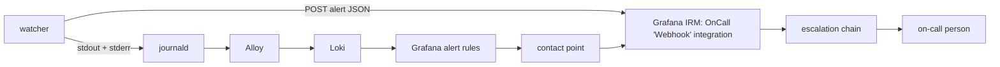

# Monitoring runbook: FeeCollector role changes

`monitoring/watcher.py` watches the six live FeeCollector contracts for `OwnerSet` and `WithdrawerSet` events. It writes one JSON line on stdout for each role change, and it can POST the same line to a webhook. It uses the Python 3 standard library only. It needs no `pip install`.

An unexpected role change means that someone can take control of the fees. Treat each alert as a possible incident until you confirm the change is planned.

## 1. What the watcher monitors

| Chain | chainId | Contract | Address |
|---|---|---|---|
| Kasplex | 202555 | Kasplex Bridge | `0x2f15c748a51438d02347878a2a0f26bc35b5e938` |
| Kasplex | 202555 | Zealous Swap (Kasplex) | `0xdfa17269221ce9fdba5bbd28f209a3a23b738978` |
| Kasplex | 202555 | KAT KRC-20 Bridge (Kasplex) | `0x642638cf9d656378b679de02fabcc5e4e7f1f915` |
| IGRA | 38833 | Zealous Swap (IGRA) | `0x2f15c748a51438d02347878a2a0f26bc35b5e938` |
| IGRA | 38833 | KAT Igra Bridge | `0x9d01e8a2f3dd0b1fc739d32ca8d79509b501eab8` |
| IGRA | 38833 | KAT Igra KRC-20 Bridge | `0x642638cf9d656378b679de02fabcc5e4e7f1f915` |

Two addresses occur on both chains, with different contracts behind them. Always read `chainId` together with `contract`. The address alone does not identify a contract.

| Event | topic0 | topics[1] | topics[2] |
|---|---|---|---|
| `OwnerSet(address,address)` | `0x342827c97908e5e2f71151c08502a66d44b6f758e3ac2f1de95f02eb95f0a735` | previous owner | new owner |
| `WithdrawerSet(address,address)` | `0x7ad56d4e6e460ed64deb189a2dba66e30e9feed79fe885f88d5fed470b2d0e8e` | previous withdrawer | new withdrawer |

`FeeRateSet` and all other events are out of scope.

Ownership transfer has two steps. `transferOwnership` emits `OwnershipTransferProposed`, which the watcher does not watch. `OwnerSet` fires only when the proposed owner calls `acceptOwnership`. The constructor emits `OwnerSet` and `WithdrawerSet` with the zero address as `previous`. `setWithdrawer` emits `WithdrawerSet`.

### Excluded deployments

The watcher does not watch these four orphan deployments:

| chainId | Address |
|---|---|
| 202555 | `0x5e40feb9cfbd572f05ea2ada9bb5935c6aa75368` |
| 202555 | `0x1e7dba18ca3c7c5fa7c7104a5e5cfe50fd73cc42` |
| 202555 | `0xad5c913a6cdbfbef88f9f7b4e15ca5fcf75cb295` |
| 38833 | `0x1e7dba18ca3c7c5fa7c7104a5e5cfe50fd73cc42` |

Why they stay excluded:

- They are superseded deployments from earlier deploy runs. They are not in `DEPLOYMENTS.md`.
- They are still callable, and they can still hold fees.
- The team has not decided whether to adopt, drain or abandon them. Until that decision is taken, they stay out of scope.
- To watch them now would raise role-change alerts on contracts that may be abandoned. Those alerts would dilute the signal from the six live contracts.

Accepted risk: an unplanned role change on an orphan deployment does not alert.

Do not add an orphan deployment to `CHAINS` as an operational step. This list changes only after the adopt/drain/abandon decision. Then it changes through a code change with its own test. `test_targets_and_topics` in `monitoring/tests/test_watcher.py` fails if an orphan address enters `CHAINS` without that change.

## 2. Run the watcher

Run all commands from the repo root.

```bash
# One poll of both chains, then exit. Exit code 1 if a chain failed.
# The first run with no state file seeds each cursor and prints no alert (section 5).
python3 -m monitoring.watcher --once

# Continuous mode (the production mode). Ctrl-C exits with code 0.
MONITOR_CONFIRMATIONS=5 MONITOR_WEBHOOK_URL='https://…' python3 -m monitoring.watcher --verbose

# Offline check against recorded responses. No network, no webhook.
python3 -m monitoring.watcher --once --fixture monitoring/fixtures/sample.json
```

| Flag | Env variable | Default | Meaning |
|---|---|---|---|
| `--once` | | off | Poll each chain one time, then exit. |
| `--interval N` | `MONITOR_INTERVAL` | `60` | Seconds between polls in continuous mode. |
| `--confirmations N` | `MONITOR_CONFIRMATIONS` | `5` | Stay N blocks behind the head. The minimum is 5: a lower value is raised to 5 with a `config` warning. |
| `--state-file PATH` | `MONITOR_STATE_FILE` | `monitoring/.state/cursors.json` | The cursor file. |
| `--backfill` | | off | First run only. Scan each chain that has no cursor from its deploy block and emit the historical alerts. Without it, a chain with no cursor is seeded at head minus confirmations and emits nothing. It never moves a cursor that exists. |
| `--fixture PATH` | | none | Replay recorded responses. It implies `--once` and turns off the webhook. It has no confirmations minimum, and the default is 0. It implies `--backfill`. |
| `--verbose` | | off | Write one `poll_ok` line for each chain on stderr. |
| | `MONITOR_WEBHOOK_URL` | none | POST each alert to this `http` or `https` URL. |
| | `MONITOR_RPC_202555` | `https://evmrpc.kasplex.org` | RPC endpoint for Kasplex. |
| | `MONITOR_RPC_38833` | `https://rpc.igralabs.com:8545` | RPC endpoint for IGRA. |

The webhook URL is an env variable only, not a flag. A flag value is visible in `ps` output.

The watcher stays 5 blocks behind the head by default. `MONITOR_CONFIRMATIONS` and `--confirmations` can only raise this value. The watcher also reads the hash of the last block of each range before and after the log query. If the hash changed, the watcher sends no alert from that range, writes a `reorg` warning and scans the range again.

When `--fixture` is set and no state file is given, the watcher uses a temporary state file. A fixture run never moves the production cursor.

### Exit codes

| Code | Meaning |
|---|---|
| 0 | `--once`: all chains polled or seeded. Continuous mode: Ctrl-C. |
| 1 | `--once`: one or more chains had an RPC error. The other chains still advanced. |
| 2 | Configuration error: a corrupt state file, an unreadable fixture, a bad flag, or a webhook URL that is not `http`/`https`. |

### Production deploy (ordered steps)

WARNING: run one instance only. The watcher has no lock file. Two pollers on one state file can send each alert two times and can overwrite each other's cursor. Do not run a manual poll against the production state file while the service runs.

1. **Prepare the host.** Use a Linux host with systemd. Install `python3` 3.8 or later and `git`. The test suite passes on Python 3.8, 3.9, 3.12 and 3.15. No `pip` packages are necessary. The host needs outbound HTTPS to `https://evmrpc.kasplex.org`, `https://rpc.igralabs.com:8545` and the webhook host.
   ```bash
   python3 --version   # expect 3.8 or later
   git --version
   ```
2. **Create the service user and the checkout.** Check out a reviewed commit, not a moving branch.
   ```bash
   sudo useradd --system --create-home --home-dir /opt/fee-watcher --shell /usr/sbin/nologin fee-watcher
   sudo chmod 0755 /opt/fee-watcher
   sudo -u fee-watcher git clone <repo-url> /opt/fee-watcher/evm-fee-collectors
   sudo -u fee-watcher git -C /opt/fee-watcher/evm-fee-collectors checkout <reviewed-commit>
   ```
   `useradd --create-home` can create `/opt/fee-watcher` with mode `0700` or `0750`. Then the operator cannot `cd` into the checkout, and the `cd` commands in step 5 and in checklist item 9 fail. The `chmod 0755` makes the checkout readable to the operator. Clone with a plain HTTPS URL or SSH, never with a token in `<repo-url>`: git keeps the URL in `.git/config`, and `0755` makes that file readable to every local user. With a plain URL, the checkout holds no secret: the webhook URL is only in `/etc/fee-watcher/watcher.env` (step 4). The state directory stays `0750`. Do not make the checkout writable to other users.
3. **Create the state directory.** The state file lives in `/var/lib/fee-watcher/cursors.json`. This directory must survive restarts, reboots and redeploys. Do not put the state file in `/tmp` or in the checkout. A lost state file makes the watcher seed again at the current block. Role changes in the gap do not alert. The `seed` warning is the only signal (section 5).
   ```bash
   sudo install -d -o fee-watcher -g fee-watcher -m 0750 /var/lib/fee-watcher
   ```
4. **Write the env file with the secret.** `MONITOR_WEBHOOK_URL` contains a secret token (section 6). Put it only in this file.
   ```bash
   sudo install -d -m 0700 /etc/fee-watcher
   sudo install -m 0600 -o root -g root /dev/null /etc/fee-watcher/watcher.env
   sudoedit /etc/fee-watcher/watcher.env
   ```
   File content:
   ```ini
   MONITOR_WEBHOOK_URL=https://<oncall-host>/integrations/v1/webhook/<token>/
   MONITOR_CONFIRMATIONS=5
   MONITOR_STATE_FILE=/var/lib/fee-watcher/cursors.json
   ```
   systemd reads `EnvironmentFile=` as root before it starts the process, so mode `0600` with owner root works.

   WARNING: never pass the webhook URL as a flag, because `ps` shows it. Never put it in the unit file, because `systemctl show` shows `Environment=` values to any user. Never commit it.
5. **Do the first run (seed).** Run one poll by hand as `fee-watcher`, without the webhook:
   ```bash
   cd /opt/fee-watcher/evm-fee-collectors
   sudo -u fee-watcher env MONITOR_STATE_FILE=/var/lib/fee-watcher/cursors.json MONITOR_CONFIRMATIONS=5 \
     python3 -m monitoring.watcher --once > /tmp/seed.jsonl
   echo "exit=$?"; wc -l < /tmp/seed.jsonl
   sudo cat /var/lib/fee-watcher/cursors.json
   ```
   Expect `exit=0`, 0 lines on stdout, two `seed` lines on stderr (chainId 202555 and 38833), and both chains in `cursors.json` with a `hash`. Events before the seed blocks are not scanned (section 5).
   - **Option: backfill.** To scan from the deploy blocks instead, run this before any seed, so that no cursor exists yet. Run it without the webhook, so the 12 constructor alerts do not page anyone:
     ```bash
     cd /opt/fee-watcher/evm-fee-collectors
     sudo -u fee-watcher env MONITOR_STATE_FILE=/var/lib/fee-watcher/cursors.json MONITOR_CONFIRMATIONS=5 \
       python3 -m monitoring.watcher --once --backfill > /tmp/backfill.jsonl
     echo "exit=$?"; wc -l < /tmp/backfill.jsonl
     ```
     Expect `exit=0` and 12 lines. The count is 12 only if no role change occurred on either chain after the deploy block. Each extra line is a role change after the deploy. If there are more than 12 lines, check each extra line with section 8 before you accept the backfill. Do not start the service until each extra line is a confirmed, planned change. Compare each `new` value with the owner and the withdrawer in `DEPLOYMENTS.md`. A mismatch is an incident (section 8). Do not put `--backfill` in the unit file.
6. **Install the systemd unit.** Write `/etc/systemd/system/fee-watcher.service`:
   ```ini
   [Unit]
   Description=FeeCollector role-change watcher
   Wants=network-online.target
   After=network-online.target

   [Service]
   Type=simple
   User=fee-watcher
   Group=fee-watcher
   WorkingDirectory=/opt/fee-watcher/evm-fee-collectors
   EnvironmentFile=/etc/fee-watcher/watcher.env
   ExecStart=/usr/bin/python3 -m monitoring.watcher --verbose
   Restart=always
   RestartSec=10
   StateDirectory=fee-watcher
   # stdout (alerts) and stderr (diagnostics) both go to the journal.
   # The log shipper reads them from there by SYSLOG_IDENTIFIER.
   StandardOutput=journal
   StandardError=journal
   SyslogIdentifier=fee-watcher
   NoNewPrivileges=true
   ProtectSystem=strict
   ProtectHome=true
   PrivateTmp=true

   [Install]
   WantedBy=multi-user.target
   ```
   `ProtectSystem=strict` makes the file system read-only for the process, except the `StateDirectory=`. The watcher writes only in the state directory: the atomic save puts its temporary file next to `cursors.json`. With `Restart=always`, a configuration error (exit code 2) restarts every 10 seconds and repeats its error line in the journal.
7. **Configure the log shipper.** Use Grafana Alloy. Grafana deprecated Promtail in favour of Alloy. Add this to the Alloy configuration on the watcher host:
   ```alloy
   loki.source.journal "fee_watcher" {
     matches    = "SYSLOG_IDENTIFIER=fee-watcher"
     labels     = {job = "fee-watcher"}
     forward_to = [loki.write.grafana_cloud.receiver]
   }

   loki.write "grafana_cloud" {
     endpoint {
       url = "https://<loki-host>/loki/api/v1/push"
       basic_auth {
         username = "<grafana-cloud-logs-user-id>"
         password = sys.env("GRAFANA_CLOUD_LOGS_TOKEN")
       }
     }
   }
   ```
   The match is on `SYSLOG_IDENTIFIER`, not on the unit, so lines sent with `systemd-cat -t fee-watcher` also reach Loki. The go-live checklist (section 6) uses this for its end-to-end test. Run `alloy fmt <config-file>` before you reload Alloy. It must exit with code 0.
8. **Start the service.**
   ```bash
   sudo systemctl daemon-reload
   sudo systemctl enable --now fee-watcher
   ```
9. **Verify the deploy.** Each check has an expected result.
   - `systemctl is-active fee-watcher` prints `active`.
   - `pgrep -fc 'monitoring.watcher'` prints `1`. Any other number breaks the one-instance rule.
   - `journalctl -u fee-watcher --since -3min -o cat` shows `poll_ok` lines for chainId 202555 and 38833, about one each 60 seconds. It shows no `rpc_error` and no `config` line.
   - `sudo cat /var/lib/fee-watcher/cursors.json` two times, 2 minutes apart: both `block` values increase.
   - `sudo systemctl restart fee-watcher`, then read the state file again: no `block` value goes back, and stdout shows no repeated alert.
   - Then complete the go-live checklist in section 6.

## 3. Alert format

Each alert is one line of JSON on stdout, with sorted keys:

```json
{"block": 20977134, "blockHash": "0x…", "chain": "Kasplex", "chainId": 202555,
 "contract": "0x2f15c748a51438d02347878a2a0f26bc35b5e938", "event": "OwnerSet",
 "label": "Kasplex Bridge", "logIndex": 0, "new": "0x…", "previous": "0x…",
 "timestamp": "2026-05-21T08:59:52+00:00", "txHash": "0x…", "type": "role_change"}
```

(The example has line breaks for this page. The real alert is one line.)

- All addresses and hashes are lowercase.
- `previous` is the zero address for the constructor events. `new` is the zero address for a renounce. Both are normal alerts.
- `timestamp` is the block time: the `timestamp` of the block that contains the event, in UTC, ISO-8601 with whole seconds. It is not the detection time. If the node gives no valid block time, the watcher sends no alert, writes `rpc_error` and tries again at the next poll.
- The webhook body is byte-for-byte the same as the stdout line, with `Content-Type: application/json`.

Stdout carries alerts only. You can pipe stdout directly into an alert pipeline.

## 4. Diagnostics on stderr

All diagnostics are JSON lines on stderr. Each line has `level`, `event` and `ts`.

| `event` | `level` | Meaning | Action |
|---|---|---|---|
| `poll_ok` | info | A chain poll completed (only with `--verbose`). Has `chainId` and `block`. | None. Its absence is the "watcher dead" signal. |
| `rpc_error` | error | A chain poll failed. Has `chainId` and `detail`. The cursor stays at the last saved block. | See section 7. |
| `reorg` | warning | The stored cursor block hash changed: the watcher rewinds 12 blocks. Or the hash of the last block of a range changed during the log query: the watcher sends no alert from that range and scans it again. | None if it is rare. Raise `MONITOR_CONFIRMATIONS` if it is frequent. |
| `webhook_failed` | warning | The webhook POST failed. Has `error` (the exception class only, never the URL). The alert is still on stdout and the cursor advances. | Check the webhook endpoint. The watcher does not retry the POST. |
| `state_corrupt` | error | The state file is unreadable. The watcher exits with code 2. | See section 7. |
| `config` | error | Bad webhook URL or unreadable fixture. The watcher exits with code 2. | Fix the configuration. |
| `config` | warning | A confirmations value below 5 was raised to 5. | Remove the low value. |
| `seed` | warning | A chain had no cursor. The watcher stored head minus confirmations and scanned no history. Has `chainId`, `block`, `hash`. | Expected on the first run only. At any other time the state file was lost: see section 7. |

## 5. State file and first run

The state file (default `monitoring/.state/cursors.json`, ignored by git) has this shape:

```json
{"version": 1, "chains": {
  "202555": {"block": 20977134, "hash": "0x…", "seen": ["<txHash>:<logIndex>", "…"]},
  "38833":  {"block": 7081273,  "hash": "0x…", "seen": []}}}
```

- `block` is the last fully scanned block. The next poll starts at `block + 1`.
- `hash` is the hash of `block`. The watcher compares it with the node at each poll to detect a re-org. `null` turns the check off for the next poll.
- `seen` holds the last 512 delivered `(txHash, logIndex)` keys for each chain. It prevents a second alert after a rewind or a crash.

The watcher writes the file atomically (temporary file, then rename) after each alert and after each scanned range. After a crash, at most one alert can be sent a second time.

### First run: seed (default)

With no cursor for a chain, and without `--backfill`, the watcher seeds that chain: it stores head minus confirmations, with the hash of that block, as the cursor. It scans no history, emits no alert and writes one `seed` warning on stderr. The next poll starts at the seed block + 1. A cursor that exists always wins: the watcher never seeds a chain again. To seed again, delete the state file deliberately.

CAUTION: a seeded cursor skips all events before that block. Do not seed past a block that you did not verify by another method.

### Backfill from the deploy block (`--backfill`)

With `--backfill` and no cursor, the watcher scans from the deploy block: 20977124 on Kasplex and 7081263 on IGRA. Each contract emitted `OwnerSet` and `WithdrawerSet` in its constructor. **A backfill therefore emits 12 alerts** (2 for each of the 6 contracts), all with `previous` = the zero address. These alerts are expected. Compare each `new` value with the owner and withdrawer in `DEPLOYMENTS.md`. `--backfill` has no effect on a chain that has a cursor.

### Seed at a chosen block (manual)

This is optional. Use it only to start at a block other than the current one. Write the state file before the first run:

1. Write the state file with `"hash": null`:
   ```json
   {"version": 1, "chains": {"202555": {"block": <kasplex block>, "hash": null, "seen": []},
                             "38833":  {"block": <igra block>,    "hash": null, "seen": []}}}
   ```
2. Run `python3 -m monitoring.watcher --once`. It must exit with code 0.

## 6. Grafana wiring

The watcher does not know Grafana. It writes stdout and stderr, and it POSTs to one webhook URL. Wire Grafana to these outputs.

There are two alert paths. Configure both.



### Alert delivery (webhook): verified path

Verified on 2026-11-18 against these Grafana documentation pages:

- Contact points: <https://grafana.com/docs/grafana/latest/alerting/configure-notifications/manage-contact-points/>. A contact point holds "integrations, or destinations for sending notifications". It is outbound only. It cannot receive the watcher's POST. Its **Test** button is "only available for Grafana Alertmanager".
- Incoming webhooks: <https://grafana.com/docs/grafana-cloud/observe-and-act/respond-to-incidents/integrations/custom-integrations/incoming-webhooks/>. Grafana IRM has "OnCall incoming webhooks" for alerts from monitoring systems.
- OnCall incoming webhooks: <https://grafana.com/docs/grafana-cloud/observe-and-act/respond-to-incidents/integrations/custom-integrations/incoming-webhooks/oncall-webhooks/>. The **Webhook** type "receives and displays the raw JSON payload exactly as it is sent". The **Formatted Webhook** type expects fields such as `alert_uid`, `title` and `state`.

Steps:

1. In Grafana IRM, open **Integrations**, then **Monitoring systems**. Select **Webhook**, not **Formatted Webhook**. The watcher sends its own JSON line, which has none of the formatted fields.
2. Click **+ New integration**. Give it a name and a team, then click **Create Integration**.
3. Copy the **Webhook URL**. Put it in `/etc/fee-watcher/watcher.env` as `MONITOR_WEBHOOK_URL` (section 2, step 4).
4. Assign the integration to the on-call escalation chain.
5. Keep **Require a Grafana service account token to send alerts to this integration** turned off. The watcher sends no `Authorization` header. With the option on, IRM rejects each POST with `403 Forbidden`, and the watcher writes `webhook_failed`.
6. Check the grouping of the integration. Each role change must make its own alert group. The documentation does not state the default grouping for the raw **Webhook** type. Check it with checklist item 9 below: two different alert lines must make two alert groups. If they make one group, set the grouping ID template from `txHash` and `logIndex` in the template editor. Confirm the result in the editor preview.

WARNING: the webhook URL is the only secret that protects the integration, because the token option stays off. Anyone with the URL can create alerts. Keep it only in the `0600` env file. Do not commit it. Do not pass it as a flag. Rotate the integration if the URL leaks.

### Go-live checklist (Grafana Cloud)

Complete each item in order. Write the date and your name in the last column. Each item gives the expected result. Any other result is a failure: stop and fix it before go-live.

Use these two saved queries:

- **Role changes:** `{job="fee-watcher"} | json | type="role_change"`
- **Watcher health:** `{job="fee-watcher"} | json | event=~"rpc_error|poll_ok"`

| # | Item | How to check | Expected result | Sign-off |
|---|---|---|---|---|
| 1 | Grafana Cloud stack | Open `https://<stack>.grafana.net`. | The stack opens. You have the Admin role. | |
| 2 | Loki data source | **Connections** > **Data sources** > the `grafanacloud-<stack>-logs` source > **Test**. | The test reports success. | |
| 3 | Log shipper ships stdout and stderr | Alloy runs on the watcher host (section 2, step 7) with label `job="fee-watcher"`. In **Explore**, run `{job="fee-watcher"}`. | Diagnostic lines (stderr) arrive within 2 minutes. Alert lines (stdout) arrive after item 9. | |
| 4 | Saved query: role changes | Save the **Role changes** query in **Explore** or in a dashboard panel. | After item 9, it returns the test alert with `chainId`, `label`, `event` and `new` as fields. | |
| 5 | Saved query: watcher health | Save the **Watcher health** query. | `poll_ok` lines for chainId 202555 and 38833, about one each 60 seconds. No `rpc_error` lines. | |
| 6 | Alert rule: role change | Grafana-managed rule on Loki: `sum by (chainId, label, event) (count_over_time({job="fee-watcher"} \| json \| type="role_change" [5m])) > 0`. Evaluate every 1m, pending period 0s. Set "Alert state if no data" to **Normal**. With no matching line the query returns no data, and the default state is **No data**, not **Normal**. This rule does not detect a silent watcher: item 7 does. | The rule is **Normal** now, not **No data**. It goes to **Firing** within 2 minutes of the Loki test in item 9. | |
| 7 | Alert rule: watcher dead | `absent_over_time({job="fee-watcher"} \| json \| event="poll_ok" [10m])`, condition `> 0`. Set "Alert state if no data" to **Normal**, because a live watcher makes this query return no data. A dead watcher is silent, so this rule is mandatory. Test: `sudo systemctl stop fee-watcher`, wait, then start it again. | **Firing** about 11 minutes after the stop. **Normal** again after the start. | |
| 8 | Extra rules | RPC errors: `sum by (chainId) (count_over_time({job="fee-watcher"} \| json \| event="rpc_error" [10m])) >= 10`. Webhook failures: `count_over_time({job="fee-watcher"} \| json \| event="webhook_failed" [5m]) > 0`. Seed after go-live (a lost state file): `count_over_time({job="fee-watcher"} \| json \| event="seed" [5m]) > 0`. On all three rules, set "Alert state if no data" to **Normal**, for the same reason as item 6. A silent watcher makes these rules **Normal** too, so item 7 must be in place. | All three rules are **Normal**, not **No data**. | |
| 9 | Webhook path end to end, with one real alert line | Tell the on-call person first. On the watcher host, run the commands under this table. | `curl` prints a `2xx` code. IRM shows one alert group with the raw JSON. The second, different line makes a second group (step 6 above). The on-call person gets the page. The Loki line makes the item 6 rule fire. | |
| 10 | Contact point and notification test | **Alerting** > **Contact points**: one contact point of type **Grafana IRM**. A notification policy routes the rules of items 6 to 8 to it. Click **Test**. | The test notification arrives in IRM and reaches the on-call person. | |
| 11 | Retention | In the Grafana Cloud portal, read the Logs retention of the stack. | Retention is at least 30 days, enough for an incident review. | |
| 12 | Named on-call owner | IRM **Schedules**: the escalation chain of the webhook integration points to a schedule. | The schedule shows a named person on call now. That person received the page in item 9. | |

Commands for item 9. They read the URL from the env file, so it does not go into shell history:

```bash
cd /opt/fee-watcher/evm-fee-collectors
python3 -m monitoring.watcher --once --fixture monitoring/fixtures/sample.json > /tmp/fixture-alerts.jsonl
# Webhook path: two different real alert lines.
for n in 1 2; do
  sed -n "${n}p" /tmp/fixture-alerts.jsonl > /tmp/alert.json
  sudo sh -c '. /etc/fee-watcher/watcher.env; curl -sS -o /dev/null -w "%{http_code}\n" -X POST \
    -H "Content-Type: application/json" --data-binary @/tmp/alert.json "$MONITOR_WEBHOOK_URL"'
done
# Loki path: one real alert line through the journal and Alloy.
head -1 /tmp/fixture-alerts.jsonl | systemd-cat -t fee-watcher
```

The fixture alerts use fake `new` addresses (`0x1111…`, `0x2222…`). Responders can tell them from a real change. Resolve the test alert groups in IRM after the check.

## 7. Troubleshooting

| Symptom | Cause | Fix |
|---|---|---|
| Repeated `rpc_error` with a range-limit or "too many results" detail on one chain | The provider rejects a 2000-block `eth_getLogs` range. | Lower `LOG_CHUNK` in `watcher.py` (for example to 500) and restart. |
| Repeated `rpc_error` with `URLError` or `timeout` | The RPC endpoint is down or slow. | Wait, or point `MONITOR_RPC_<chainId>` to another endpoint. The cursor does not move, so no events are lost. |
| `rpc_error` with `block N not found` | A load-balanced node lags behind. | None. The next poll retries. Alerts already sent are in `seen`. |
| `rpc_error` with `no valid timestamp` or `does not match log blockHash` | The node gave a block header without a valid block time, or a header that does not agree with its logs. | None if it is rare: the next poll retries, and the cursor does not move. If it repeats, point `MONITOR_RPC_<chainId>` to another endpoint. |
| Frequent `reorg` warnings | A node lags, or the chain re-orgs. | Raise `MONITOR_CONFIRMATIONS`. |
| Exit code 2 with `state_corrupt` | The state file is damaged. | Do not delete the file without a decision. Delete it and run `--once --backfill` without the webhook to replay from the deploy blocks, or delete it and let the watcher seed (this skips the gap). |
| Unexpected `seed` warning after go-live | The state file was lost or replaced. The watcher seeded at head minus confirmations and scanned no history. | Role changes in the gap did not alert. Find out why the state file was lost. Replay with `--once --backfill` only after a decision, because it re-sends the historical alerts. `--backfill` does not move a cursor that exists, so delete the new state file first. |
| No alerts and no `poll_ok` lines | The watcher stopped, or stderr is not shipped. | Check the process supervisor and the log shipper. |

## 8. Respond to a role-change alert

1. Read `chainId`, `label`, `event`, `previous` and `new` from the alert.
2. Open `txHash` in the explorer of that chain: `https://explorer.kasplex.org/tx/<txHash>` or `https://explorer.igralabs.com/tx/<txHash>`.
3. Confirm with the team that the change is planned. Compare `new` with the planned owner or withdrawer.
4. If the change is planned, update `DEPLOYMENTS.md` with the new address.
5. If the change is not planned, start the incident procedure at once.
   - Unplanned `WithdrawerSet`: the owner key calls `setWithdrawer` with the correct address. The withdrawer role controls `withdrawNative` and `withdrawAllNative` (and `withdraw` / `withdrawAll` where the contract has them).
   - Unplanned `OwnerSet`: the old owner key no longer controls the contract. Treat the owner key as compromised.

WARNING: an unplanned `OwnerSet` gives full control of the contract to `new`. The new owner can call `setWithdrawer` and then withdraw the fees. Act at once.

## 9. Limits

- An ownership proposal (`OwnershipTransferProposed`) does not alert. Only the accepted transfer (`OwnerSet`) alerts.
- The default first run seeds. Events before the seed block never alert.
- A re-org deeper than 12 blocks is not fully scanned again.
- After a re-org, a transaction mined again with a different `logIndex` alerts a second time.
- Delivery is at-least-once only for the alert in progress at a crash.
- The webhook POST has one attempt with a 5-second timeout and no retry. The stdout line and the Loki rule are the backup path.

## 10. Tests

```bash
python3 -m unittest discover -s monitoring/tests -t . -v
```

CI runs this command on each pull request that touches `monitoring/` (`.github/workflows/monitoring.yml`).

The tests are hermetic: no network, no sleep, temporary files only. `monitoring/fixtures/sample.json` documents the fixture format. Each key is `"<chainId>|<method>|<params as compact sorted JSON>"` and each value is a full JSON-RPC response.
